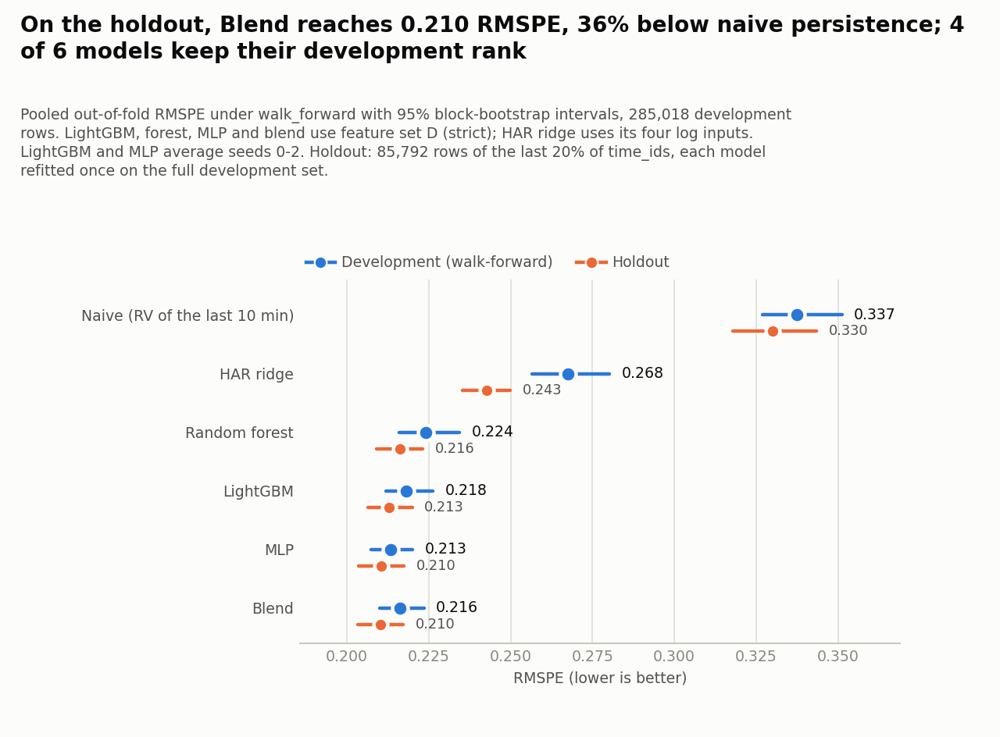

# How much of a volatility forecast is look-ahead?

[](https://github.com/gauronaldo/lob-volatility-forecast/actions/workflows/ci.yml)


Forecasting the next 10 minutes of realized volatility for 112 stocks from
order-book and trade data ([Kaggle Optiver](https://www.kaggle.com/competitions/optiver-realized-volatility-prediction)).
The competition shuffled its time intervals, and top solutions recovered the
order and borrowed features from neighbouring intervals **on both sides in
time**. This project rebuilds that pipeline under a pre-registered protocol
and measures how much accuracy survives when a model may only use the past.

## Results

RMSPE, lower is better, with 95% block-bootstrap intervals. Development is
walk-forward on the first 80% of intervals in recovered time order; the
holdout is the last 20%, opened once after every model was frozen.

<!-- BEGIN:headline -->
| Model | Features | Development RMSPE | Holdout RMSPE | Dev train s |
| --- | --- | --- | --- | --- |
| Naive (RV of the last 10 min) | A | 0.3374 (0.3269 to 0.3512) | 0.3299 (0.3178 to 0.3435) | 0 |
| HAR ridge | A | 0.2675 (0.2566 to 0.2802) | 0.2426 (0.2352 to 0.2499) | 3 |
| Random forest | D | 0.2241 (0.2159 to 0.2343) | 0.2162 (0.2091 to 0.2232) | 314 |
| LightGBM | D | 0.2182 (0.2120 to 0.2262) | 0.2129 (0.2064 to 0.2199) | 159 |
| MLP | D | 0.2133 (0.2073 to 0.2200) | 0.2104 (0.2035 to 0.2175) | 753 |
| Blend | D | 0.2162 (0.2099 to 0.2235) | 0.2103 (0.2034 to 0.2173) | 0 |
| LightGBM (look-ahead) | C_comp | 0.2137 (0.2073 to 0.2217) | 0.2075 (0.2008 to 0.2143) | 183 |

| Paired difference in RMSPE | Development | Holdout |
| --- | --- | --- |
| Validation: random rows to walk-forward (same model) | 0.2207 to 0.2418 | - |
| Look-ahead gain (C_strict - C_comp) | +0.0076 (+0.0060 to +0.0091) | +0.0081 (+0.0064 to +0.0096) |
| Past neighbours and lags (D - B) | -0.0235 (-0.0276 to -0.0197) | -0.0137 (-0.0166 to -0.0109) |
| Order-error sensitivity (D_gap - D) | +0.0061 (+0.0045 to +0.0080) | +0.0056 (+0.0040 to +0.0071) |
| MLP - LightGBM | -0.0049 (-0.0069 to -0.0033) | -0.0025 (-0.0035 to -0.0016) |
<!-- END:headline -->



- **Look-ahead is real:** neighbours from the future lower the error on both
  sets; that gain is unavailable to a live forecaster.
- **The honest gain is still large:** past neighbours and lags carry most of
  the improvement; stock-level statistics and clusters add nothing.
- **Validation matters:** the same model looks about 9% better under
  shuffled rows than under walk-forward.
- **The MLP edges out tuned LightGBM** at several times the training cost.

All tables, the other four figures and the error analysis are in
[reports/report.md](reports/report.md).

## Quick start

```
pip install -e ".[dev]"
pytest -q                            # synthetic data, no download needed
```

With the Kaggle data extracted into `data/raw/`:

```
python -m lobvol all                 # audit, features, time order, splits, models, report
python -m lobvol holdout --confirm   # final evaluation, runs once
```

The full run takes about two hours on a 12-core CPU. Each stage also has its
own command (`audit`, `features`, `order`, `splits`, `xsection`, `train`,
`evaluate`); see `python -m lobvol --help`.

## Repository

| Path | Contents |
| --- | --- |
| `src/lobvol/` | the pipeline: features, time-order recovery, splits, models, evaluation |
| `configs/` | frozen parameters, gates and the run matrix |
| `tests/` | leakage, causality and formula tests on synthetic data |
| `results/` | metrics, tables, figures and run records |
| [`docs/METHOD.md`](docs/METHOD.md) | research protocol |
| [`docs/DEVIATIONS.md`](docs/DEVIATIONS.md) | where the code departs from it, and why |
| [`docs/HANDOFF.md`](docs/HANDOFF.md) | project state and open items |

## Limitations

- The time order is inferred, so the strict setting may keep some look-ahead
  from local order errors.
- One dataset, one period, anonymised stocks; no trading backtest is possible.
- The competition test set is not used, so scores are not comparable with the
  Kaggle leaderboard.
