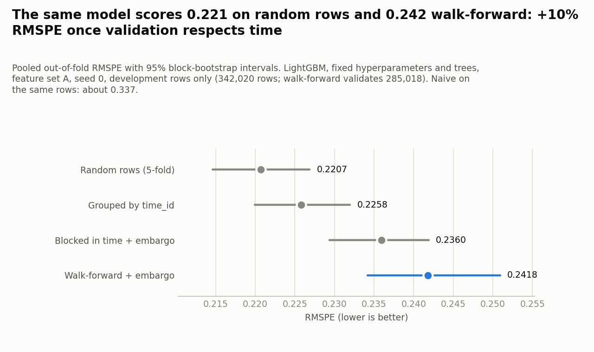
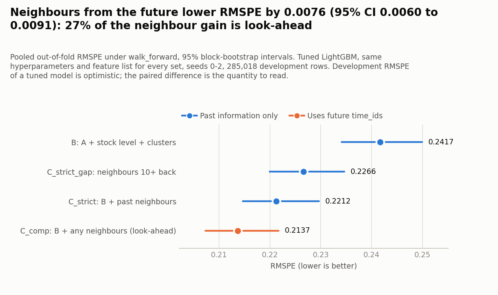
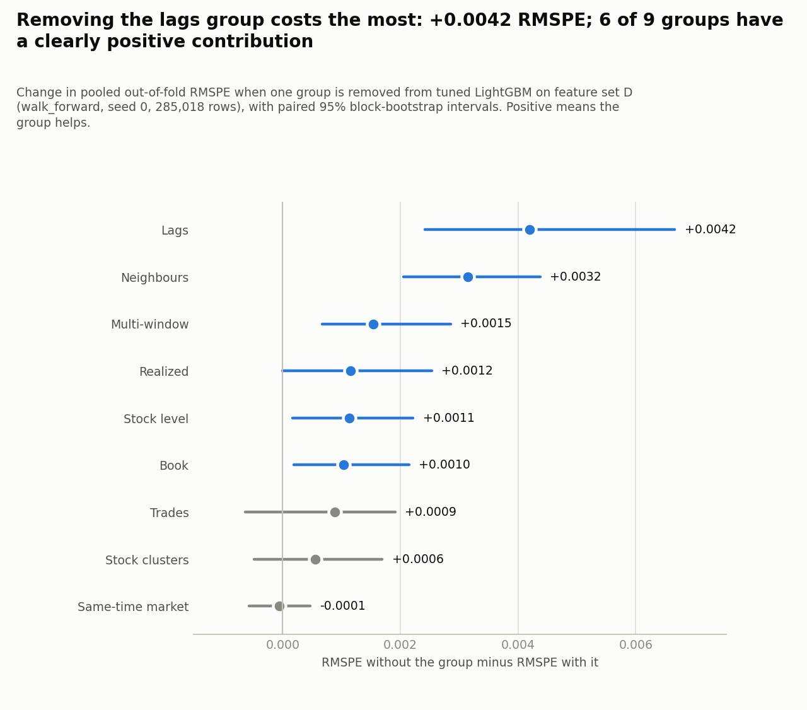
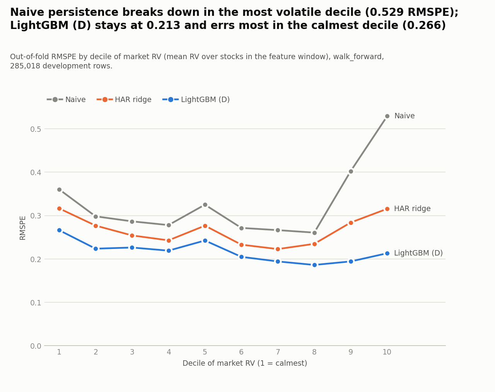

# How much of a volatility forecast is look-ahead?

[](https://github.com/gauronaldo/lob-volatility-forecast/actions/workflows/ci.yml)

Forecasting the next 10 minutes of realized volatility for 112 stocks from 10
minutes of limit-order-book and trade data (Kaggle, *Optiver Realized
Volatility Prediction*), under one constraint the competition did not
impose: **a model may only use information available at forecast time.**

The competition shuffled its time intervals, and the strongest public
solutions recovered their order and borrowed features from neighbouring
intervals on both sides in time. This project rebuilds that pipeline with a
pre-registered protocol ([docs/METHOD.md](docs/METHOD.md)) and measures what
survives when the future is off-limits.

## Findings

- **The time order can be recovered.** Real prices are reconstructed from the
  tick size and the intervals are chained end-to-start; the order passes every
  check that needs no ground truth, and the method was chosen on synthetic
  data with a known order.
- **Validation choice matters, but less than folklore suggests.** Moving from
  shuffled rows to walk-forward raises the error of the same model by about a
  tenth; each step of the ladder is significant (figure 1).
- **Look-ahead is real and measurable.** Allowing neighbours from the future
  lowers RMSPE on both the development set and the untouched holdout;
  roughly a quarter to two fifths of the gain of the competition setting over
  the base features comes from the future (figure 2).
- **The honest gain is still large.** Past neighbours and lags carry most of
  the improvement over in-bucket features; stock-level statistics and
  clusters add nothing. Part of the strict gain depends on the recovered
  order being right locally, which a gap of 10 intervals measures.
- **A small neural network beats tuned LightGBM, at a cost.** The MLP wins by
  a small but significant margin on both sets and trains several times
  longer; a blend adds nothing over the MLP.
- **The holdout confirms the development results.** Every difference whose
  interval excluded zero in development keeps its sign on the holdout.

Every number below is written by `python -m lobvol evaluate`. RMSPE, lower is
better; intervals are 95% paired block-bootstrap intervals over consecutive
time_ids. *Development* is walk-forward out-of-fold on the first 80% of
time_ids in recovered order; the *holdout* is the last 20%, opened once after
every model was frozen.


### Holdout

<!-- BEGIN:holdout -->
Holdout: 766 time_ids, 85,792 rows; every model refitted on the full development set; naive RMSPE on the same rows 0.3299.

| model | features | rmspe | interval | seeds | train_seconds |
| --- | --- | --- | --- | --- | --- |
| Naive (RV of the last 10 min) | A | 0.3299 | 0.3178 to 0.3435 | 0 | 0 |
| HAR ridge | A | 0.2426 | 0.2352 to 0.2499 | 0 | 1 |
| Random forest | D | 0.2162 | 0.2091 to 0.2232 | 0 | 105 |
| LightGBM | A | 0.2262 | 0.2194 to 0.2325 | 0 1 2 | 75 |
| LightGBM | B | 0.2266 | 0.2198 to 0.2330 | 0 1 2 | 56 |
| LightGBM | C_strict | 0.2155 | 0.2087 to 0.2226 | 0 1 2 | 20 |
| LightGBM | C_comp | 0.2075 | 0.2008 to 0.2143 | 0 1 2 | 17 |
| LightGBM | C_strict_gap | 0.2194 | 0.2123 to 0.2266 | 0 1 2 | 18 |
| LightGBM | D | 0.2129 | 0.2064 to 0.2199 | 0 1 2 | 20 |
| LightGBM | D_gap | 0.2186 | 0.2113 to 0.2257 | 0 1 2 | 19 |
| MLP | D | 0.2104 | 0.2035 to 0.2175 | 0 1 2 | 245 |
| Blend | D | 0.2103 | 0.2034 to 0.2173 | - | 0 |

Paired differences on the holdout (95% block-bootstrap intervals):

| comparison | rmspe_a | rmspe_b | difference | ci_low | ci_high |
| --- | --- | --- | --- | --- | --- |
| RQ3 look-ahead: C_strict minus C_comp | 0.2155 | 0.2075 | +0.0081 | +0.0064 | +0.0096 |
| RQ1: LightGBM A minus naive | 0.2262 | 0.3299 | -0.1038 | -0.1141 | -0.0949 |
| RQ1: B minus A | 0.2266 | 0.2262 | +0.0005 | +0.0002 | +0.0007 |
| RQ1: C_strict minus B | 0.2155 | 0.2266 | -0.0111 | -0.0138 | -0.0084 |
| RQ1: D minus C_strict | 0.2129 | 0.2155 | -0.0026 | -0.0036 | -0.0018 |
| RQ1: D minus B | 0.2129 | 0.2266 | -0.0137 | -0.0166 | -0.0109 |
| Order error: C_strict_gap minus C_strict | 0.2194 | 0.2155 | +0.0038 | +0.0024 | +0.0051 |
| Order error: C_strict_gap minus B | 0.2194 | 0.2266 | -0.0073 | -0.0104 | -0.0044 |
| Order error: D_gap minus D | 0.2186 | 0.2129 | +0.0056 | +0.0040 | +0.0071 |
| Order error: D_gap minus B | 0.2186 | 0.2266 | -0.0081 | -0.0114 | -0.0051 |
| Model: HAR ridge minus naive | 0.2426 | 0.3299 | -0.0874 | -0.0967 | -0.0796 |
| Model: forest minus HAR ridge | 0.2162 | 0.2426 | -0.0264 | -0.0289 | -0.0233 |
| Model: LightGBM D minus forest | 0.2129 | 0.2162 | -0.0033 | -0.0041 | -0.0024 |
| RQ4: MLP minus LightGBM D | 0.2104 | 0.2129 | -0.0025 | -0.0035 | -0.0016 |
| Model: blend minus LightGBM D | 0.2103 | 0.2129 | -0.0026 | -0.0034 | -0.0019 |

Diebold-Mariano tests on adjacent rungs (negative statistic: the model beats the rung below it):

| ladder | model | against | statistic | p_value | lag |
| --- | --- | --- | --- | --- | --- |
| features | gbdt__A | naive__A | -17.85 | 0.0000 | 9 |
| features | gbdt__B | gbdt__A | +3.51 | 0.0005 | 9 |
| features | gbdt__C_strict | gbdt__B | -9.50 | 0.0000 | 9 |
| features | gbdt__D | gbdt__C_strict | -5.74 | 0.0000 | 9 |
| models | har_ridge__A | naive__A | -17.11 | 0.0000 | 9 |
| models | forest__D | har_ridge__A | -18.46 | 0.0000 | 9 |
| models | gbdt__D | forest__D | -6.77 | 0.0000 | 9 |
| models | mlp__D | gbdt__D | -5.05 | 0.0000 | 9 |
| models | blend__D | mlp__D | -0.85 | 0.3982 | 9 |
<!-- END:holdout -->

### All comparisons

<!-- BEGIN:findings -->
| Comparison (A minus B) | Development | Holdout |
| --- | --- | --- |
| RQ3 look-ahead: C_strict minus C_comp | +0.0076 (+0.0060 to +0.0091): higher RMSPE (interval above zero) | +0.0081 (+0.0064 to +0.0096): higher RMSPE (interval above zero) |
| RQ1: LightGBM A minus naive | -0.0959 (-0.1042 to -0.0885): lower RMSPE (interval below zero) | -0.1038 (-0.1141 to -0.0949): lower RMSPE (interval below zero) |
| RQ1: B minus A | +0.0002 (-0.0005 to +0.0010): no clear difference (interval contains zero) | +0.0005 (+0.0002 to +0.0007): higher RMSPE (interval above zero) |
| RQ1: C_strict minus B | -0.0205 (-0.0244 to -0.0168): lower RMSPE (interval below zero) | -0.0111 (-0.0138 to -0.0084): lower RMSPE (interval below zero) |
| RQ1: D minus C_strict | -0.0030 (-0.0045 to -0.0018): lower RMSPE (interval below zero) | -0.0026 (-0.0036 to -0.0018): lower RMSPE (interval below zero) |
| RQ1: D minus B | -0.0235 (-0.0276 to -0.0197): lower RMSPE (interval below zero) | -0.0137 (-0.0166 to -0.0109): lower RMSPE (interval below zero) |
| Order error: C_strict_gap minus C_strict | +0.0054 (+0.0038 to +0.0070): higher RMSPE (interval above zero) | +0.0038 (+0.0024 to +0.0051): higher RMSPE (interval above zero) |
| Order error: C_strict_gap minus B | -0.0151 (-0.0180 to -0.0120): lower RMSPE (interval below zero) | -0.0073 (-0.0104 to -0.0044): lower RMSPE (interval below zero) |
| Order error: D_gap minus D | +0.0061 (+0.0045 to +0.0080): higher RMSPE (interval above zero) | +0.0056 (+0.0040 to +0.0071): higher RMSPE (interval above zero) |
| Order error: D_gap minus B | -0.0175 (-0.0208 to -0.0141): lower RMSPE (interval below zero) | -0.0081 (-0.0114 to -0.0051): lower RMSPE (interval below zero) |
| Model: HAR ridge minus naive | -0.0699 (-0.0781 to -0.0626): lower RMSPE (interval below zero) | -0.0874 (-0.0967 to -0.0796): lower RMSPE (interval below zero) |
| Model: forest minus HAR ridge | -0.0434 (-0.0500 to -0.0368): lower RMSPE (interval below zero) | -0.0264 (-0.0289 to -0.0233): lower RMSPE (interval below zero) |
| Model: LightGBM D minus forest | -0.0059 (-0.0093 to -0.0034): lower RMSPE (interval below zero) | -0.0033 (-0.0041 to -0.0024): lower RMSPE (interval below zero) |
| RQ4: MLP minus LightGBM D | -0.0049 (-0.0069 to -0.0033): lower RMSPE (interval below zero) | -0.0025 (-0.0035 to -0.0016): lower RMSPE (interval below zero) |
| Model: blend minus LightGBM D | -0.0019 (-0.0033 to -0.0007): lower RMSPE (interval below zero) | -0.0026 (-0.0034 to -0.0019): lower RMSPE (interval below zero) |
| RQ2: group_time minus kfold_rows | +0.0051 (+0.0040 to +0.0062): higher RMSPE (interval above zero) | not evaluated |
| RQ2: blocked_time minus group_time | +0.0101 (+0.0074 to +0.0125): higher RMSPE (interval above zero) | not evaluated |
| RQ2: walk_forward minus blocked_time | +0.0099 (+0.0071 to +0.0131): higher RMSPE (interval above zero) | not evaluated |
<!-- END:findings -->

<table>
<tr>
<td></td>
<td></td>
</tr>
<tr>
<td></td>
<td></td>
</tr>
</table>

The full write-up, with the order validation, sanity anchors, ablation, SHAP
and error analysis, is in [reports/report.md](reports/report.md).

## Approach

1. **Audit** the raw order book and trades without looking at targets.
2. **In-bucket features** on a forward-filled 1-second grid: realized
   variance, quarticity and semivariance over three windows, spreads, depth,
   imbalance and trade activity.
3. **Recover the time order** of the shuffled intervals from prices
   reconstructed via the tick size.
4. **Cut the holdout** (last 20% in time, with an embargo) before any target
   is used, and save one set of folds for four validation schemes.
5. **Cross-sectional and temporal features** in a strict setting (past
   neighbours and lags only) and a competition setting (neighbours on both
   sides), plus gap variants that test sensitivity to order errors.
6. **Model ladder** on identical folds: naive persistence, HAR ridge, random
   forest, LightGBM (Optuna, tuned once), an MLP with stock embeddings, and a
   blend; all aligned with the RMSPE loss.
7. **Evaluate** with block-bootstrap intervals and Diebold-Mariano tests;
   **open the holdout once**.

Leakage guards are tested, not assumed: the test suite checks that no split
shares a time_id, that every strict neighbour and lag points backwards, and
that randomising all future targets leaves every strict feature
bit-identical.

## Repository layout

```
configs/            base.yaml (frozen parameters, gates, run matrix), models/*.yaml
docs/               METHOD.md (protocol), DEVIATIONS.md
src/lobvol/
  audit.py          S1 data audit
  realized.py       WAP, returns, RV, quarticity, semivariance
  features.py       in-bucket features
  time_order.py     price recovery and time-order recovery
  cv.py             holdout cut, folds, embargo
  cross_section.py  market, stock-level, cluster, neighbour and lag features
  models/           naive, har, forest, gbdt, mlp, blend
  pipeline.py       feature selection, tuning, runs on saved folds
  evaluation.py     RMSPE, block bootstrap, Diebold-Mariano
  report.py         tables, figures, generated report blocks
  holdout.py        the only reader of holdout targets
  synth.py          synthetic data in the Optiver format, for tests
  cli.py
tests/              synthetic data only
results/            metrics, tables, figures, run records
reports/report.md   full write-up
```

## Reproduce

Python 3.11.

```
pip install -e ".[dev]"
pytest -q                                # synthetic data, no download needed
```

The competition data is not in this repository. Accept the rules of the
Kaggle competition, download the data and extract it into `data/raw/` so that
`data/raw/train.csv`, `data/raw/book_train.parquet/` and
`data/raw/trade_train.parquet/` exist. Then:

```
python -m lobvol audit        # S1 data audit
python -m lobvol features     # S2 in-bucket features
python -m lobvol order        # S3 time-order recovery
python -m lobvol splits       # S4 holdout cut and folds
python -m lobvol xsection     # S6 neighbour and lag features (both settings)
python -m lobvol train        # S5 leakage ladder and gates, S7 model ladder
python -m lobvol evaluate     # tables, intervals, figures, report blocks
python -m lobvol all          # all of the above, never the holdout
python -m lobvol holdout --confirm   # S8, runs once
```

Every command reads `configs/base.yaml`, skips work whose outputs exist unless
`--force` is given, and writes a run record (config, package versions, git
commit, seeds). A single run is
`python -m lobvol train --model <name> --features <set> --scheme <scheme>`.
On a 12-core CPU without a GPU the whole pipeline took about two hours, most
of it the model ladder (LightGBM tuning, seeds and ablation, and the MLP); the
holdout run took about 11 minutes.

## Limitations

- No trading backtest is possible on this dataset: prices are normalised and
  the buckets are sampled.
- The time order is inferred, not known, so the strict setting may keep some
  look-ahead from local order errors.
- One dataset, one period, anonymised stocks.
- The competition test set is not used, so the scores are not comparable with
  the Kaggle leaderboard.

## Acknowledgements

Ideas, not code, come from public write-ups of the competition (nyanp, 1st
place; michaelpoluektov/orvp, 7th; chrisrichardmiles, 91st;
abh-win/hf-realized-volatility; itsbykov/optiver-volatility) and from Corsi
(2009), Diebold and Mariano (1995), Harvey, Leybourne and Newbold (1997) and
Lopez de Prado (2018). Details in [docs/METHOD.md](docs/METHOD.md#8-references-ideas-only-no-code-was-copied).
