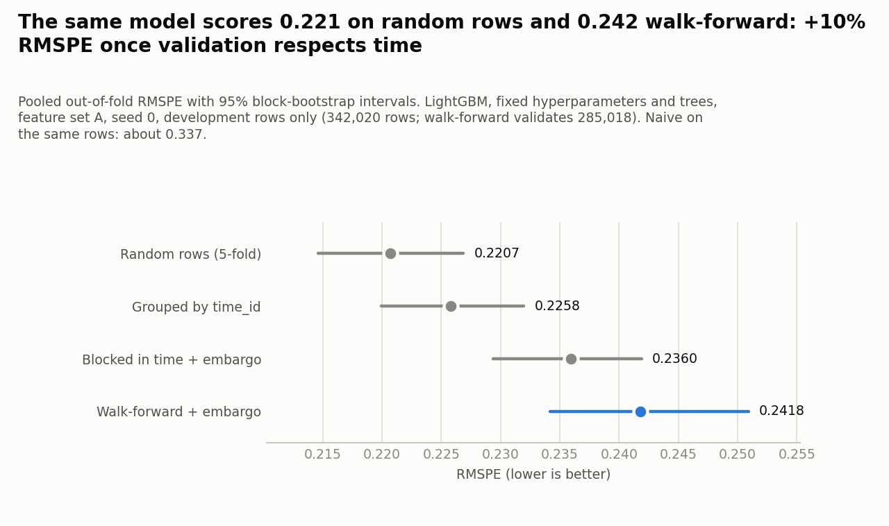
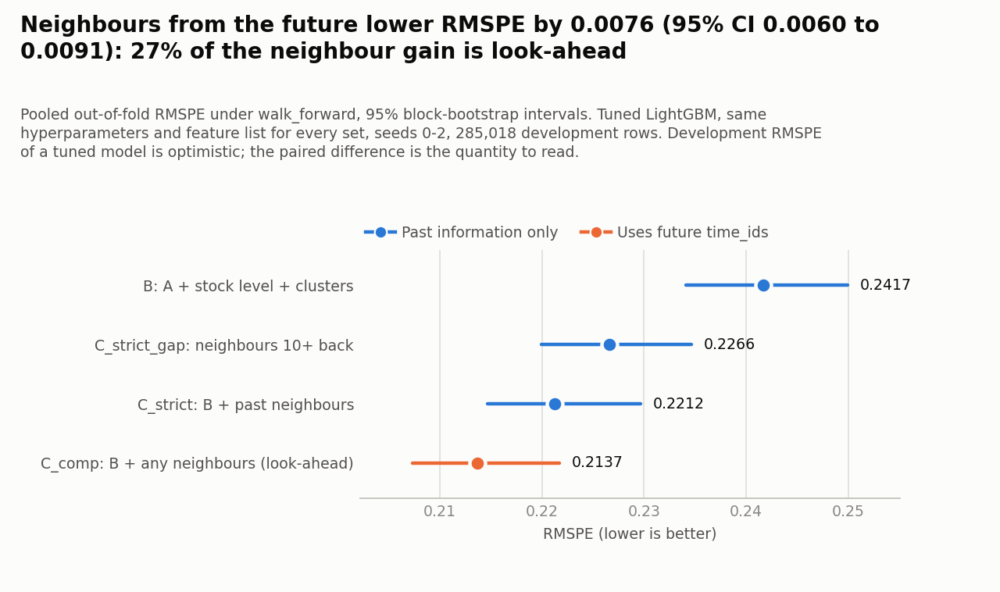
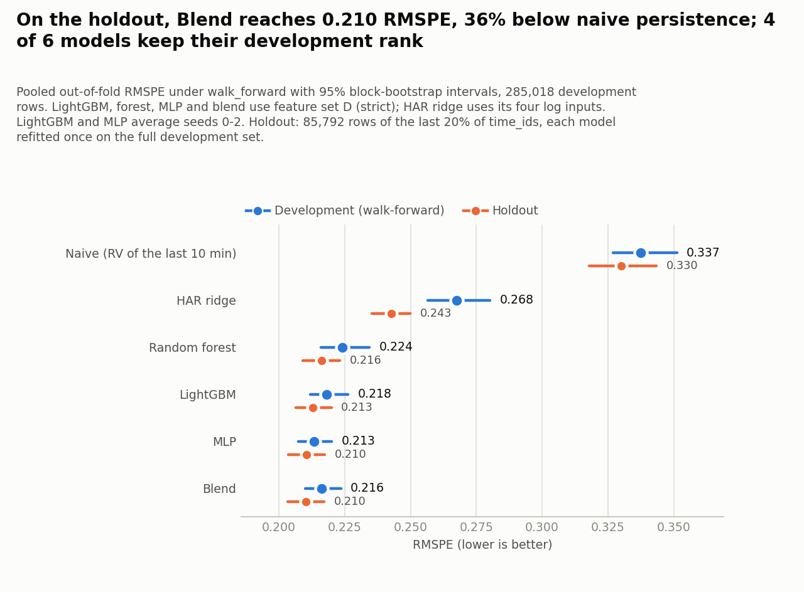
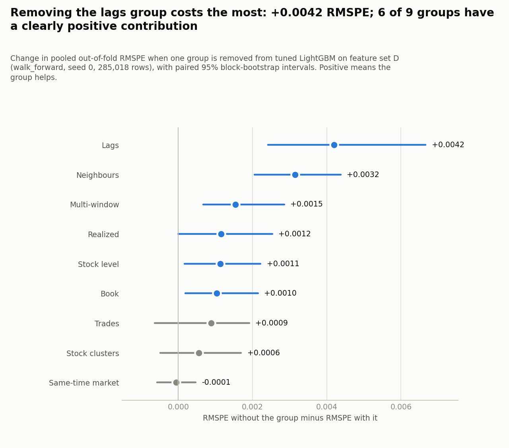
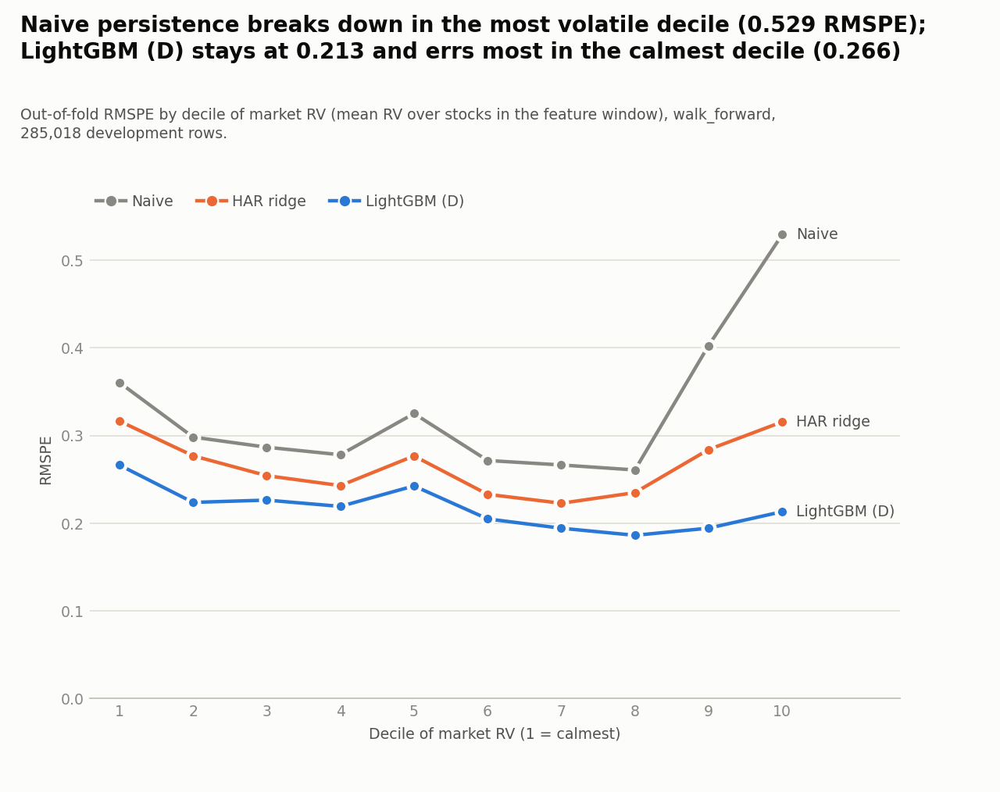

# How much volatility-forecast accuracy survives without look-ahead

Optiver Realized Volatility Prediction data: forecast the realized volatility
(RV) of the next 10 minutes for 112 anonymised stocks from 10 minutes of order
book and trades. The question is not the leaderboard score but how much of
the usual accuracy remains when a model may use only information available at
forecast time.

Every table between `BEGIN` and `END` markers is written by
`python -m lobvol evaluate`; do not edit it by hand. Metric: RMSPE, lower is
better. Intervals are 95% paired moving-block bootstrap intervals over
consecutive time_ids (1,000 resamples, blocks of 20 time_ids, all stocks of a
time_id kept together).

## Findings

In short (values in the table below and in the sections that follow):

1. **Validation scheme (RQ2).** The same fixed LightGBM loses accuracy at
   every step from random rows to walk-forward validation. Random rows let the
   model see other stocks of the same 10 minutes; grouping by time_id removes
   that, blocking in time removes neighbouring periods, and walk-forward adds
   smaller training sets and drift. Each step has an interval above zero.
2. **Look-ahead in neighbour features (RQ3).** Letting nearest-neighbour
   time_ids come from the future lowers RMSPE on both the development folds
   and the holdout, with intervals clear of zero. Of the gain that
   competition-style neighbour features show over feature set B, about a
   quarter is look-ahead on the development folds and about two fifths on the
   holdout; the rest survives in the strict setting.
3. **Features (RQ1).** Everything a single bucket offers already gives a large
   cut over naive persistence. Adding stock-level statistics and stock
   clusters to that (set B) gives no gain, and a small loss on the holdout.
   Past neighbours bring the largest further gain and lags a smaller one; in
   the ablation, lags and neighbours are the two groups whose removal costs
   most.
4. **Neural network (RQ4).** The MLP beats tuned LightGBM on feature set D on
   both the development folds and the holdout by a small margin with an
   interval below zero, at several times the training time. On the holdout a
   blend of the models is not distinguishable from the MLP
   (Diebold-Mariano).
5. **Holdout.** Every gain found on the development folds holds on the
   holdout with an interval clear of zero, and the order of the model ladder
   is the same apart from the near-tie of blend and MLP. All RMSPE values are
   a little lower on the holdout, naive included, so the last 20% of the
   period is somewhat easier to forecast; the gains from neighbour features
   are smaller there than on the development folds.

<!-- BEGIN:findings -->
| Comparison (A minus B) | Development | Holdout |
| --- | --- | --- |
| RQ3 look-ahead: C_strict minus C_comp | +0.0076 (+0.0060 to +0.0091): higher RMSPE (interval above zero) | +0.0081 (+0.0064 to +0.0096): higher RMSPE (interval above zero) |
| RQ1: LightGBM A minus naive | -0.0959 (-0.1042 to -0.0885): lower RMSPE (interval below zero) | -0.1038 (-0.1141 to -0.0949): lower RMSPE (interval below zero) |
| RQ1: B minus A | +0.0002 (-0.0005 to +0.0010): no clear difference (interval contains zero) | +0.0005 (+0.0002 to +0.0007): higher RMSPE (interval above zero) |
| RQ1: C_strict minus B | -0.0205 (-0.0244 to -0.0168): lower RMSPE (interval below zero) | -0.0111 (-0.0138 to -0.0084): lower RMSPE (interval below zero) |
| RQ1: D minus C_strict | -0.0030 (-0.0045 to -0.0018): lower RMSPE (interval below zero) | -0.0026 (-0.0036 to -0.0018): lower RMSPE (interval below zero) |
| RQ1: D minus B | -0.0235 (-0.0276 to -0.0197): lower RMSPE (interval below zero) | -0.0137 (-0.0166 to -0.0109): lower RMSPE (interval below zero) |
| Order error: C_strict_gap minus C_strict | +0.0054 (+0.0038 to +0.0070): higher RMSPE (interval above zero) | +0.0038 (+0.0024 to +0.0051): higher RMSPE (interval above zero) |
| Order error: C_strict_gap minus B | -0.0151 (-0.0180 to -0.0120): lower RMSPE (interval below zero) | -0.0073 (-0.0104 to -0.0044): lower RMSPE (interval below zero) |
| Order error: D_gap minus D | +0.0061 (+0.0045 to +0.0080): higher RMSPE (interval above zero) | +0.0056 (+0.0040 to +0.0071): higher RMSPE (interval above zero) |
| Order error: D_gap minus B | -0.0175 (-0.0208 to -0.0141): lower RMSPE (interval below zero) | -0.0081 (-0.0114 to -0.0051): lower RMSPE (interval below zero) |
| Model: HAR ridge minus naive | -0.0699 (-0.0781 to -0.0626): lower RMSPE (interval below zero) | -0.0874 (-0.0967 to -0.0796): lower RMSPE (interval below zero) |
| Model: forest minus HAR ridge | -0.0434 (-0.0500 to -0.0368): lower RMSPE (interval below zero) | -0.0264 (-0.0289 to -0.0233): lower RMSPE (interval below zero) |
| Model: LightGBM D minus forest | -0.0059 (-0.0093 to -0.0034): lower RMSPE (interval below zero) | -0.0033 (-0.0041 to -0.0024): lower RMSPE (interval below zero) |
| RQ4: MLP minus LightGBM D | -0.0049 (-0.0069 to -0.0033): lower RMSPE (interval below zero) | -0.0025 (-0.0035 to -0.0016): lower RMSPE (interval below zero) |
| Model: blend minus LightGBM D | -0.0019 (-0.0033 to -0.0007): lower RMSPE (interval below zero) | -0.0026 (-0.0034 to -0.0019): lower RMSPE (interval below zero) |
| RQ2: group_time minus kfold_rows | +0.0051 (+0.0040 to +0.0062): higher RMSPE (interval above zero) | not evaluated |
| RQ2: blocked_time minus group_time | +0.0101 (+0.0074 to +0.0125): higher RMSPE (interval above zero) | not evaluated |
| RQ2: walk_forward minus blocked_time | +0.0099 (+0.0071 to +0.0131): higher RMSPE (interval above zero) | not evaluated |
<!-- END:findings -->

## Data and setup

<!-- BEGIN:data -->
- Stocks: 112; time_ids: 3,830 (development 3,054, embargo 10, holdout 766).
- Development rows: 342,020.
- LightGBM tuning: 40 Optuna TPE trials on feature set B, walk_forward, seed 0; best mean fold RMSPE 0.2410 (trial 18). Chosen: learning_rate 0.05, max_bin 255, max_rounds 3000, early_stopping_rounds 100, num_leaves 57, min_data_in_leaf 334, feature_fraction 0.6, bagging_fraction 0.597, lambda_l1 4.35, lambda_l2 3.24.
<!-- END:data -->

The time_ids are shuffled in the raw data. Their order was recovered from
prices (section "Time order") and every temporal split, lag and neighbour
feature depends on that estimate. The last 20% of time_ids in recovered order
form the holdout, separated from the development set by an embargo of 10
time_ids. The holdout was cut before any model was fitted and opened once, at
stage S8, after every model was frozen.

Feature sets:

- **A**: in-bucket features (RV of WAP1, WAP2 and trades over 600/300/150 s,
  quarticity, semivariance, RV per minute, spread, imbalance, depth, trades)
  and same-time market features (leave-one-out mean and std of RV over the
  other stocks).
- **B**: A plus stock-level statistics and stock-cluster RV, fitted on the
  training rows of each fold.
- **C_strict**: B plus the mean RV of the 5 and 20 nearest earlier time_ids,
  in price space and in volatility space.
- **C_comp**: as C_strict, but the neighbours may come from the future (the
  competition setting).
- **D**: C_strict plus lags: RV and realized target of the previous time_id
  and the mean over the previous 6.
- **C_strict_gap, D_gap**: as C_strict and D, but every neighbour and lag lies
  at least 10 time_ids back, to measure the effect of local order errors.

## Time order

Each bucket's prices are normalised, but the smallest gap between its price
levels is one tick of 0.01, which gives the price level P0 of the stock in that
bucket. With real prices in hand, each time_id is linked to the time_id whose
start prices are closest to its end prices, across all stocks at once; the
resulting chain is refined by moving segments of up to 30 time_ids. The
end-to-start distance is asymmetric, so the chain also has a direction. A
second, independent cue agrees: targets correlate more with the next bucket's
RV than with the previous one, computed on the first 80% of time_ids only.

The method was chosen on synthetic data with a known order, generated with
trading days and overnight gaps. The plan's primary method (Isomap on the
start-price matrix) failed that test, and on the real data it scored far
worse on every check that needs no ground truth (table below); see
[docs/DEVIATIONS.md](../docs/DEVIATIONS.md).

<!-- BEGIN:order -->
Method: `end_start_chain`; status: **ok**.

| Check | Value | Result |
| --- | --- | --- |
| synthetic Spearman rho | 1 | ok |
| synthetic 99th percentile displacement | 3 | ok |
| direction cues agree | 0.07109 | ok |
| jump ratio (consecutive / random pairs) | 0.016 | ok |
| jump permutation p-value | 0.000999 | ok |
| lag-1 autocorrelation of market log-RV | 0.7169 | ok |

| Method on real data | Rank displacement p99 against the method used | Best-successor share | Lag-1 autocorrelation of market log-RV |
| --- | --- | --- | --- |
| isomap | 1523 | 0.070 | 0.390 |
| greedy_2opt | 485 | 0.651 | 0.719 |
| isomap_2opt | 94 | 0.676 | 0.718 |
| end_start_chain | 0 | 0.768 | 0.717 |
<!-- END:order -->

## Sanity anchors

Public solutions report naive persistence at about 0.341 and a GroupKFold
LightGBM at about 0.226, on all rows. Here both are measured on development
rows only, because no target was read before the holdout was cut.

<!-- BEGIN:gates -->
| Gate (development rows) | Value | Required | Result |
| --- | --- | --- | --- |
| Naive RMSPE, 342,020 rows | 0.3442 | 0.33 to 0.35 | ok |
| LightGBM, feature set A, group_time | 0.2258 | below 0.24 | ok |
<!-- END:gates -->

## RQ2: validation schemes



One LightGBM with fixed hyperparameters and a fixed number of trees, feature
set A, scored under four schemes on the same development rows. Read the steps
in order:

- random rows to grouped by time_id: same-interval leakage, since other stocks
  of the same 10 minutes share most of the volatility;
- grouped to blocked in time with an embargo: proximity in time, since
  neighbouring periods share a volatility regime;
- blocked to walk-forward: not leakage alone, as each walk-forward fold also
  trains on less data and validates later in the period.

The three RQ2 rows of the findings table give each step with its paired
interval. A score from random-row cross-validation, the default in many
public notebooks, is therefore optimistic for a model that has to forecast
the future.

## RQ3: look-ahead in neighbour features



C_strict and C_comp share the tuned hyperparameters and the feature list; they
differ only in whether the nearest time_ids may lie in the future. The
difference is the look-ahead, and it has the same size on the development
folds and on the holdout.

The gap variant asks a harder question. Strict neighbours can still carry
look-ahead if the recovered order swaps two adjacent time_ids. Requiring every
neighbour and lag to lie at least 10 time_ids back costs part of the gain, but
most of the improvement over B remains. The lost part is an upper bound on
the effect of local order errors: it also includes genuinely useful
information from the most recent periods, and the two cannot be separated on
this data.

## RQ1 and RQ4: features and models





Models. HAR ridge, four log RVs and a stock effect, already removes a large
share of naive's error. Trees on feature set D cut further, and the MLP adds a
small, consistent improvement over LightGBM. Two caveats on that comparison:
LightGBM was tuned on the development metric and the MLP was not, which
favours LightGBM on the development folds; the holdout, where neither has
that advantage, still shows the MLP ahead, by a smaller margin. And the MLP
costs several times the training time of LightGBM (column `train_seconds`).
The blend's development score suffers in the first walk-forward fold, where
no earlier out-of-fold predictions exist to fit its weights and equal weights
are used.

Features. Adding stock-level statistics and clusters to set A gives no gain:
`stock_id` is already a categorical input. Inside set D, removing the
stock-level group costs a little while removing the clusters costs nothing
measurable, and the same-time market features add nothing once neighbours
are present. The ablation and SHAP agree that the temporal groups,
neighbours and lags, carry most of the signal of the honest model.

Every development run (`results/model_table.csv`). "Tuned" marks runs whose
hyperparameters were chosen on this very metric, which makes their
development RMSPE optimistic.

<!-- BEGIN:model_table -->
| model | features | scheme | rmspe_mean | rmspe_sd_folds | rmspe_pooled | interval | naive_rmspe_mean | n_rows | seeds | train_seconds | tuned |
| --- | --- | --- | --- | --- | --- | --- | --- | --- | --- | --- | --- |
| LightGBM (fixed) | A | blocked_time | 0.2358 | 0.0106 | 0.2360 | 0.2294 to 0.2419 | 0.3440 | 342,020 | 0 | 14 | no |
| LightGBM (fixed) | A | group_time | 0.2258 | 0.0032 | 0.2258 | 0.2199 to 0.2320 | 0.3442 | 342,020 | 0 | 14 | no |
| LightGBM (fixed) | A | kfold_rows | 0.2207 | 0.0046 | 0.2207 | 0.2146 to 0.2269 | 0.3442 | 342,020 | 0 | 15 | no |
| MLP | D | walk_forward | 0.2131 | 0.0093 | 0.2133 | 0.2073 to 0.2200 | 0.3369 | 285,018 | 0 1 2 | 753 | no |
| LightGBM | C_comp | walk_forward | 0.2134 | 0.0111 | 0.2137 | 0.2073 to 0.2217 | 0.3369 | 285,018 | 0 1 2 | 183 | yes |
| Blend | D | walk_forward | 0.2160 | 0.0113 | 0.2162 | 0.2099 to 0.2235 | 0.3369 | 285,018 | - | 0 | no |
| LightGBM | D | walk_forward | 0.2179 | 0.0121 | 0.2182 | 0.2120 to 0.2262 | 0.3369 | 285,018 | 0 1 2 | 159 | yes |
| LightGBM | C_strict | walk_forward | 0.2209 | 0.0128 | 0.2212 | 0.2147 to 0.2297 | 0.3369 | 285,018 | 0 1 2 | 152 | yes |
| Random forest | D | walk_forward | 0.2235 | 0.0182 | 0.2241 | 0.2159 to 0.2343 | 0.3369 | 285,018 | 0 | 314 | no |
| LightGBM | D_gap | walk_forward | 0.2240 | 0.0127 | 0.2242 | 0.2178 to 0.2325 | 0.3369 | 285,018 | 0 1 2 | 145 | yes |
| LightGBM | C_strict_gap | walk_forward | 0.2264 | 0.0123 | 0.2266 | 0.2199 to 0.2346 | 0.3369 | 285,018 | 0 1 2 | 125 | yes |
| LightGBM | A | walk_forward | 0.2408 | 0.0209 | 0.2415 | 0.2340 to 0.2496 | 0.3369 | 285,018 | 0 1 2 | 33 | yes |
| LightGBM | B | walk_forward | 0.2410 | 0.0212 | 0.2417 | 0.2341 to 0.2500 | 0.3369 | 285,018 | 0 1 2 | 139 | yes |
| LightGBM (fixed) | A | walk_forward | 0.2414 | 0.0154 | 0.2418 | 0.2342 to 0.2509 | 0.3369 | 285,018 | 0 | 10 | no |
| HAR ridge | A | walk_forward | 0.2662 | 0.0300 | 0.2675 | 0.2566 to 0.2802 | 0.3369 | 285,018 | 0 | 3 | no |
| Naive (RV of the last 10 min) | A | walk_forward | 0.3369 | 0.0206 | 0.3374 | 0.3269 to 0.3512 | 0.3369 | 285,018 | 0 | 0 | no |
<!-- END:model_table -->

Paired differences on the development set:

<!-- BEGIN:differences -->
| comparison | rmspe_a | rmspe_b | difference | ci_low | ci_high | n_rows |
| --- | --- | --- | --- | --- | --- | --- |
| RQ3 look-ahead: C_strict minus C_comp | 0.2212 | 0.2137 | +0.0076 | +0.0060 | +0.0091 | 285,018 |
| RQ1: LightGBM A minus naive | 0.2415 | 0.3374 | -0.0959 | -0.1042 | -0.0885 | 285,018 |
| RQ1: B minus A | 0.2417 | 0.2415 | +0.0002 | -0.0005 | +0.0010 | 285,018 |
| RQ1: C_strict minus B | 0.2212 | 0.2417 | -0.0205 | -0.0244 | -0.0168 | 285,018 |
| RQ1: D minus C_strict | 0.2182 | 0.2212 | -0.0030 | -0.0045 | -0.0018 | 285,018 |
| RQ1: D minus B | 0.2182 | 0.2417 | -0.0235 | -0.0276 | -0.0197 | 285,018 |
| Order error: C_strict_gap minus C_strict | 0.2266 | 0.2212 | +0.0054 | +0.0038 | +0.0070 | 285,018 |
| Order error: C_strict_gap minus B | 0.2266 | 0.2417 | -0.0151 | -0.0180 | -0.0120 | 285,018 |
| Order error: D_gap minus D | 0.2242 | 0.2182 | +0.0061 | +0.0045 | +0.0080 | 285,018 |
| Order error: D_gap minus B | 0.2242 | 0.2417 | -0.0175 | -0.0208 | -0.0141 | 285,018 |
| Model: HAR ridge minus naive | 0.2675 | 0.3374 | -0.0699 | -0.0781 | -0.0626 | 285,018 |
| Model: forest minus HAR ridge | 0.2241 | 0.2675 | -0.0434 | -0.0500 | -0.0368 | 285,018 |
| Model: LightGBM D minus forest | 0.2182 | 0.2241 | -0.0059 | -0.0093 | -0.0034 | 285,018 |
| RQ4: MLP minus LightGBM D | 0.2133 | 0.2182 | -0.0049 | -0.0069 | -0.0033 | 285,018 |
| Model: blend minus LightGBM D | 0.2162 | 0.2182 | -0.0019 | -0.0033 | -0.0007 | 285,018 |
| RQ2: group_time minus kfold_rows | 0.2258 | 0.2207 | +0.0051 | +0.0040 | +0.0062 | 342,020 |
| RQ2: blocked_time minus group_time | 0.2360 | 0.2258 | +0.0101 | +0.0074 | +0.0125 | 342,020 |
| RQ2: walk_forward minus blocked_time | 0.2418 | 0.2319 | +0.0099 | +0.0071 | +0.0131 | 285,018 |
<!-- END:differences -->

Ablation (tuned LightGBM, feature set D, seed 0):

<!-- BEGIN:ablation -->
| group | rmspe_without_group | delta | ci_low | ci_high |
| --- | --- | --- | --- | --- |
| Lags | 0.2221 | +0.0042 | +0.0024 | +0.0067 |
| Neighbours | 0.2211 | +0.0032 | +0.0021 | +0.0044 |
| Multi-window | 0.2195 | +0.0015 | +0.0007 | +0.0029 |
| Realized | 0.2191 | +0.0012 | +0.0000 | +0.0025 |
| Stock level | 0.2191 | +0.0011 | +0.0002 | +0.0022 |
| Book | 0.2190 | +0.0010 | +0.0002 | +0.0021 |
| Trades | 0.2188 | +0.0009 | -0.0006 | +0.0019 |
| Stock clusters | 0.2185 | +0.0006 | -0.0005 | +0.0017 |
| Same-time market | 0.2179 | -0.0001 | -0.0006 | +0.0005 |
<!-- END:ablation -->

Share of mean absolute SHAP value by feature group (tuned LightGBM, feature
set D, last walk-forward fold):

<!-- BEGIN:shap -->
| group | n_features | share |
| --- | --- | --- |
| Neighbours | 16 | 37.0% |
| Lags | 7 | 20.9% |
| Trades | 10 | 10.6% |
| Multi-window | 17 | 9.3% |
| Stock level | 3 | 5.8% |
| Book | 8 | 5.8% |
| Same-time market | 3 | 4.7% |
| Realized | 5 | 4.7% |
| Stock clusters | 2 | 1.0% |
<!-- END:shap -->

## Holdout

The model list, configs and code were frozen (`results/holdout/freeze.json`
records the source hash), every model was refitted once on the full
development set, and the last 20% of time_ids were predicted once. Strict
features of holdout rows use earlier holdout time_ids, including their
realized targets, as a live forecaster would. No modelling change was made
after the holdout was opened.

<!-- BEGIN:holdout -->
Holdout: 766 time_ids, 85,792 rows; every model refitted on the full development set; naive RMSPE on the same rows 0.3299.

| model | features | rmspe | interval | seeds | train_seconds |
| --- | --- | --- | --- | --- | --- |
| Naive (RV of the last 10 min) | A | 0.3299 | 0.3178 to 0.3435 | 0 | 0 |
| HAR ridge | A | 0.2426 | 0.2352 to 0.2499 | 0 | 1 |
| Random forest | D | 0.2162 | 0.2091 to 0.2232 | 0 | 105 |
| LightGBM | A | 0.2262 | 0.2194 to 0.2325 | 0 1 2 | 75 |
| LightGBM | B | 0.2266 | 0.2198 to 0.2330 | 0 1 2 | 56 |
| LightGBM | C_strict | 0.2155 | 0.2087 to 0.2226 | 0 1 2 | 20 |
| LightGBM | C_comp | 0.2075 | 0.2008 to 0.2143 | 0 1 2 | 17 |
| LightGBM | C_strict_gap | 0.2194 | 0.2123 to 0.2266 | 0 1 2 | 18 |
| LightGBM | D | 0.2129 | 0.2064 to 0.2199 | 0 1 2 | 20 |
| LightGBM | D_gap | 0.2186 | 0.2113 to 0.2257 | 0 1 2 | 19 |
| MLP | D | 0.2104 | 0.2035 to 0.2175 | 0 1 2 | 245 |
| Blend | D | 0.2103 | 0.2034 to 0.2173 | - | 0 |

Paired differences on the holdout (95% block-bootstrap intervals):

| comparison | rmspe_a | rmspe_b | difference | ci_low | ci_high |
| --- | --- | --- | --- | --- | --- |
| RQ3 look-ahead: C_strict minus C_comp | 0.2155 | 0.2075 | +0.0081 | +0.0064 | +0.0096 |
| RQ1: LightGBM A minus naive | 0.2262 | 0.3299 | -0.1038 | -0.1141 | -0.0949 |
| RQ1: B minus A | 0.2266 | 0.2262 | +0.0005 | +0.0002 | +0.0007 |
| RQ1: C_strict minus B | 0.2155 | 0.2266 | -0.0111 | -0.0138 | -0.0084 |
| RQ1: D minus C_strict | 0.2129 | 0.2155 | -0.0026 | -0.0036 | -0.0018 |
| RQ1: D minus B | 0.2129 | 0.2266 | -0.0137 | -0.0166 | -0.0109 |
| Order error: C_strict_gap minus C_strict | 0.2194 | 0.2155 | +0.0038 | +0.0024 | +0.0051 |
| Order error: C_strict_gap minus B | 0.2194 | 0.2266 | -0.0073 | -0.0104 | -0.0044 |
| Order error: D_gap minus D | 0.2186 | 0.2129 | +0.0056 | +0.0040 | +0.0071 |
| Order error: D_gap minus B | 0.2186 | 0.2266 | -0.0081 | -0.0114 | -0.0051 |
| Model: HAR ridge minus naive | 0.2426 | 0.3299 | -0.0874 | -0.0967 | -0.0796 |
| Model: forest minus HAR ridge | 0.2162 | 0.2426 | -0.0264 | -0.0289 | -0.0233 |
| Model: LightGBM D minus forest | 0.2129 | 0.2162 | -0.0033 | -0.0041 | -0.0024 |
| RQ4: MLP minus LightGBM D | 0.2104 | 0.2129 | -0.0025 | -0.0035 | -0.0016 |
| Model: blend minus LightGBM D | 0.2103 | 0.2129 | -0.0026 | -0.0034 | -0.0019 |

Diebold-Mariano tests on adjacent rungs (negative statistic: the model beats the rung below it):

| ladder | model | against | statistic | p_value | lag |
| --- | --- | --- | --- | --- | --- |
| features | gbdt__A | naive__A | -17.85 | 0.0000 | 9 |
| features | gbdt__B | gbdt__A | +3.51 | 0.0005 | 9 |
| features | gbdt__C_strict | gbdt__B | -9.50 | 0.0000 | 9 |
| features | gbdt__D | gbdt__C_strict | -5.74 | 0.0000 | 9 |
| models | har_ridge__A | naive__A | -17.11 | 0.0000 | 9 |
| models | forest__D | har_ridge__A | -18.46 | 0.0000 | 9 |
| models | gbdt__D | forest__D | -6.77 | 0.0000 | 9 |
| models | mlp__D | gbdt__D | -5.05 | 0.0000 | 9 |
| models | blend__D | mlp__D | -0.85 | 0.3982 | 9 |
<!-- END:holdout -->

## Error analysis



<!-- BEGIN:errors -->
| decile | n_rows | naive | har_ridge | gbdt_A | gbdt_D | blend |
| --- | --- | --- | --- | --- | --- | --- |
| 1 | 28,560 | 0.3604 | 0.3164 | 0.2721 | 0.2662 | 0.2612 |
| 2 | 28,448 | 0.2981 | 0.2768 | 0.2387 | 0.2236 | 0.2212 |
| 3 | 28,556 | 0.2866 | 0.2541 | 0.2394 | 0.2262 | 0.2237 |
| 4 | 28,446 | 0.2780 | 0.2428 | 0.2289 | 0.2190 | 0.2158 |
| 5 | 28,446 | 0.3250 | 0.2766 | 0.2607 | 0.2424 | 0.2361 |
| 6 | 28,559 | 0.2714 | 0.2328 | 0.2190 | 0.2047 | 0.2010 |
| 7 | 28,447 | 0.2663 | 0.2226 | 0.2142 | 0.1941 | 0.1925 |
| 8 | 28,558 | 0.2606 | 0.2347 | 0.2156 | 0.1860 | 0.1886 |
| 9 | 28,447 | 0.4025 | 0.2839 | 0.2376 | 0.1942 | 0.1965 |
| 10 | 28,551 | 0.5292 | 0.3155 | 0.2786 | 0.2130 | 0.2155 |
<!-- END:errors -->

Naive persistence fails most in the most volatile markets, where volatility
tends to fall back. LightGBM flattens that spike and errs most in the calmest
decile instead; HAR ridge sits in between. One stock dominates the per-stock errors: it has the
lowest price level, so one tick is a large relative move. Forecasts are on
average below realized volatility in every decile of the forecast. That is by
design: the RMSPE-optimal forecast of a skewed target lies below its mean.

Further tables: `results/error_by_stock.csv`, `results/error_by_time.csv`,
`results/calibration.csv`, `results/error_summary.json` (with and without the
least liquid stock).

## Limitations

- No trading backtest is possible on this dataset: prices are normalised
  within each bucket and the buckets are a sample of the trading day.
- The time order is inferred, not known. The strict setting is strict only
  relative to that estimate, so it may keep some look-ahead from local order
  errors; the gap variants measure how much this matters. The ordering
  methods disagree with each other well beyond the embargo of 10 time_ids at
  their 99th percentile of rank displacement (section "Time order"), so the
  order is reliable locally only in the sense the synthetic test checks.
- One dataset, one period, anonymised stocks.
- The competition test set is not used.
- Five folds are few: fold standard deviations are descriptive, and claims
  rest on the bootstrap intervals.
- Deviations from the protocol in [docs/METHOD.md](../docs/METHOD.md) are
  listed in [docs/DEVIATIONS.md](../docs/DEVIATIONS.md).

## Reproduce

```
pip install -e ".[dev]"
python -m lobvol all                 # S1..S7 and evaluate
python -m lobvol holdout --confirm   # S8, once, after every model is frozen
python -m lobvol evaluate            # adds the holdout to the report
```
